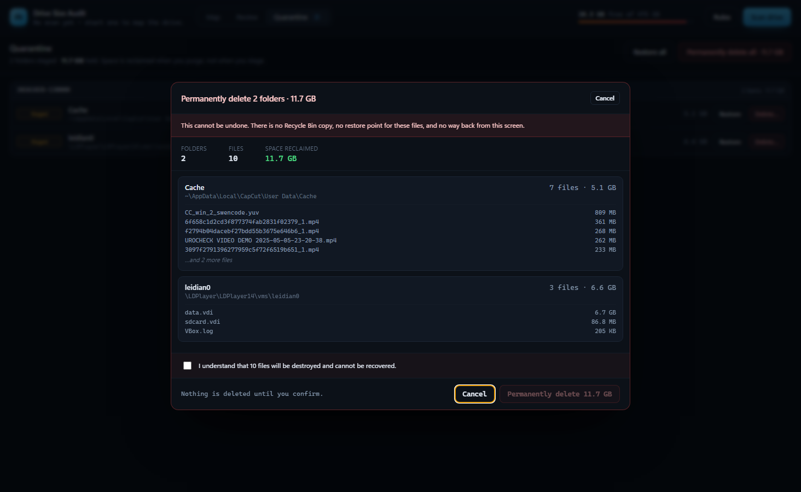

# Drive Size Audit

A local, read-first disk audit tool for Windows. It maps an entire drive, classifies every
folder by how safe it is to remove, and puts the decision in front of you — one row, one
reason, one checkbox at a time.

Built because `Get-ChildItem -Recurse` on a 400 GB drive takes ten minutes and tells you
nothing actionable.



> **Windows only, and it really deletes files.** Quarantine is reversible; purge is not.
> Read [Known limitations](#known-limitations) before pointing it at a drive you care about.

## What it does

- **Scans** a drive in parallel and caches the result, so the second open is instant.
- **Maps** the result as a treemap coloured by risk tier, drill-down on click.
- **Classifies** every folder above 1 MB against a readable rule set.
- **Explains** every candidate: category, why it is safe (or not), and what breaks if removed.
- **Quarantines** approved folders by same-volume rename — instant, restorable.
- **Purges** on a second, explicit confirmation. This is the step that frees space.

Measured on a 474 GB drive: 376,999 folders / 1,864,471 files / 418 GB in **172 seconds**,
then ~600 ms to classify on every subsequent open.

## Install and run

Requirements: **Windows 10/11**, **Node.js 20+** (22 recommended), ~400 MB for `node_modules`.

```bash
# from a checkout of this repository
npm install
npm run build
npm start          # or: npm run dev  (hot reload)
```

**No prebuilt binary yet.** Running from source is the supported path until packaging lands
(see [Roadmap](#roadmap)).

On first launch, click **Scan drive**. The scan is a one-time cost; results are cached in
`%APPDATA%\Drive Size Audit\scan-cache.json`, so every later open is instant.

## Commands

| Command | Purpose |
| --- | --- |
| `npm run dev` | Electron + Vite with hot reload |
| `npm run build` | Production build into `out/` |
| `npm start` | Run the production build |
| `npm test` | Unit tests (classification invariants) |
| `npm run typecheck` | TypeScript, no emit |
| `npm run scan -- 'C:\'` | Headless scan + report to the terminal |
| `npm run scan -- 'C:\' --cached` | Re-classify the existing cache after editing rules |
| `npm run scan -- 'C:\' --save` | Write `.cache/scan.json` |

## The safety model

Four components, only one of which can ever touch your files:

1. **Scanner** — read-only. Walks the tree, caches to JSON.
2. **Classifier** — read-only *by construction*. It takes a path, returns a verdict. It has
   no filesystem write capability, so a bug here can annoy you, not delete anything.
3. **UI** — read-only. Renders, selects, explains.
4. **Executor** — the only unit with write power. It acts only on an explicit list of
   folders you approved, refuses anything it did not classify as removable, and journals
   its intent before touching the disk.

### How a cleanup actually runs

```
Review → tick folders → Quarantine selected → [review the plan] → confirm
        → Quarantine view → Restore (undo) or Permanently delete (frees space)
```

1. Every batch appends a `begin` record listing exactly what is about to move.
2. Each folder is renamed into `%APPDATA%\Drive Size Audit\quarantine\<batch>\<drive>\<full path>`.
   A rename on the same volume is instant and needs no free space — which matters on a
   drive that is already full.
3. Each result appends a `quarantine` record. A crash mid-batch leaves `interrupted`
   items that are shown in the UI, not silently lost.
4. **Restore** reverses the mapping exactly and refuses if anything has reappeared at the
   original path.
5. **Purge** deletes the staged copy. The button names the byte count and requires a
   second click.

### What the executor refuses

| Situation | Behaviour |
| --- | --- |
| `KEEP` / `LOCKED` tier | refused, even if the UI sends it |
| drive root (`C:\`) | refused |
| anything inside the quarantine folder | refused |
| a different volume from the quarantine | refused — unless a per-volume root is resolved (see below) |
| symbolic link or junction | refused |
| path vanished since the scan | skipped, with a reason |
| folder in use by another program | skipped with `EBUSY`/`EPERM` — apps are never force-closed |
| destination already exists | staged as `name (2)` rather than overwriting |

### Multi-drive staging

A move must be a rename, so staged folders have to sit on the same volume as their source.
The system volume uses the app data folder; **any other volume gets
`<drive>:\DriveSizeAuditQuarantine`**. Without this, cleaning a second drive would refuse
every item as cross-volume.

### Risk tiers

| Tier | Meaning | Selectable |
| --- | --- | --- |
| 🟢 `SAFE_PURGE` | Regenerates itself: package caches, shader caches, Temp, build artifacts | yes |
| 🟡 `REVIEW` | Needs your judgement: model weights, emulator images, Downloads, app data | yes |
| 🔵 `KEEP` | Your data, or a folder containing it | yes, never pre-selected |
| 🔴 `LOCKED` | System-critical (`WinSxS`, `System32`, `Windows\Installer`) | **no** |

### Two invariants worth knowing

**Nested folders never double-count.** A folder's size includes its children. If `CapCut`
and `CapCut\Cache` were both listed at full size, selecting both would promise bytes that
only exist once. Every candidate reports an *exclusive* size — its own bytes minus any
nested group — so the total is always truthful.

**Protection is monotonic downward.** If a folder is `KEEP`, everything beneath it is
protected, even if a broader rule would otherwise match it. This is what stops
`Roaming\.tlauncher` (a 30 GB reviewable folder) from sweeping up the Minecraft worlds
nested inside it. A parent holding protected data is flagged and cannot be removed whole.

## Editing the rules

`rules/rules.json` is the whole classification system — plain JSON, no rebuild needed.
Matched in order; first match wins. `%LOCALAPPDATA%`-style tokens expand at runtime.

```json
{
  "id": "purge-node-modules",
  "tier": "SAFE_PURGE",
  "category": "Build artifact",
  "reason": "Installed JS dependencies. Run `npm install` to recreate.",
  "requiresSibling": "package.json",
  "match": { "name": "node_modules" }
}
```

**Matchers on one rule are ANDed.** A rule fires only when every matcher it declares
passes, which is what makes "this name, but only under that tree" expressible:

```json
{ "match": { "prefix": "%PROGRAMFILES%", "name": "node_modules" } }
```

- `match.prefix` — path prefix
- `match.name` — final path segment (`node_modules`, `saves`)
- `match.regex` — full-path regular expression
- `requiresSibling: "package.json"` — only match when that file sits inside the folder.
  A `node_modules` without a manifest beside it is not regenerable, so it is never
  offered.
- `display: true` — colours the map but is not a review item and blocks nothing
  (used for catch-alls like "the rest of `C:\Windows`")

### Path tokens

`%LOCALAPPDATA%`, `%APPDATA%`, `%USERPROFILE%`, `%PROGRAMDATA%`, `%PROGRAMFILES%`,
`%PROGRAMFILES(X86)%`, `%PUBLIC%`, `%WINDIR%`, `%TEMP%`, `%SYSTEMDRIVE%`.

Shell folders use dedicated tokens resolved through the **Windows Known Folder API** at
startup, so OneDrive redirection and folders moved to another drive are handled:

`%DOCUMENTS%` `%DESKTOP%` `%DOWNLOADS%` `%PICTURES%` `%MUSIC%` `%VIDEOS%`

Without them, a OneDrive-redirected `Documents` would silently fail to match and lose its
protection.

### Overrides

Put personal rules in `rules/overrides.json` (same shape, `{ "rules": [ ... ] }`). They are
prepended to the shipped set, so they win the first-match race, and they survive an app
update. This is the file to hand someone when they say "my tool keeps showing up as unclassified".

Add a rule, run `npm run scan -- 'C:\' --cached`, and the new classification appears in
under a second.

## Roadmap

- **Inspection layer** — read the contents of a candidate folder (extension mix, largest files,
  hash-named vs human-named) so a verdict rests on evidence, not on the folder's name. This is
  the highest-value next step: it is what would have caught the `CapCut\Cache` case before a
  rule was written wrong.
- **AI layer** — the provider code is written and tested (`src/shared/ai/*`, 18 tests) but not
  wired to the UI. Design constraint already enforced in code: **the AI's maximum verdict is
  `REVIEW`. Only a deterministic rule may say `SAFE_PURGE`**, so a wrong model opinion can never
  put a file on the delete pile.
- **Elevated tier** — `hiberfil.sys`, Windows Update cache, DISM component cleanup, behind a
  separate UAC-gated helper that re-validates every path itself.
- **Duplicates and verification reporting.**
- **Packaging** — installer and portable build, code signing, and an uninstaller that asks what
  to do with anything still staged.
- **Chat over the index** — ask questions about the scan with read-only tools, not a general
  assistant.

## Layout

```
src/shared/     scanner.ts, rules.ts, executor.ts, types.ts   (no Electron imports — testable alone)
src/main/       Electron main process, IPC, tree building
src/preload/    contextBridge API (contextIsolation on, nodeIntegration off)
src/renderer/   React UI — treemap, review list, inspector, plan, quarantine
rules/          rules.json
tests/          classification invariants + executor round-trips (real filesystem)
scripts/        headless scan / debug
```

## Environment overrides

| Variable | Purpose |
| --- | --- |
| `DSA_DRIVE` | drive letter to scan (default `%SYSTEMDRIVE%`) |
| `DSA_CACHE` | use a specific scan cache instead of the user-data one |
| `DSA_USERDATA` | portable profile — lets a run use an isolated cache/journal/quarantine |

The executor tests move, restore and purge real folders inside a temp directory; they never
touch a real scan target. Run them with `npm test`.

## Known limitations

- **Windows only.** The scanner, path rules, Known Folder resolution and the executor are all
  Win32-specific.
- **No prebuilt binary, no installer, no code signing.** Build from source. An unsigned
  Electron build would trigger SmartScreen anyway.
- **The elevated tier is missing.** `hiberfil.sys`, the Windows Update cache and `WinSxS` are
  deliberately untouched — the app will not ask for administrator rights in this version.
- **One volume at a time.** Point it at a drive with `DSA_DRIVE`. Quarantine is created on the
  same volume as the item (`<drive>:\DriveSizeAuditQuarantine` off the system volume).
- **The shipped rules are a starting set.** They cover Windows itself, common caches and dev
  tooling; vendor rules for CapCut, LDPlayer, TLauncher, Pinokio and Arduino are inert on a
  machine that doesn't have those apps. Add `rules/overrides.json` for yours.
- **Purge is permanent.** There is no Recycle Bin copy and no restore after purge. Quarantine
  is the reversible step; the confirmation screen is the last one.
- **Quarantine lives under `%APPDATA%`.** Deleting that folder, or uninstalling, loses anything
  still staged.
- **A folder in use is skipped, never force-closed.** Close the owning app and retry.
- **AI is not wired to the UI.** The provider code exists and is tested; there is no button yet.

## Privacy

No telemetry, no analytics, no network calls during scanning or cleanup. The app reads file
names and sizes to compute totals — it does not read file contents. An optional local or cloud
model provider exists in `src/shared/ai/`, but it is not reachable from the UI in this version;
if you wire it up yourself, nothing is sent anywhere until you configure a provider.

## License

[MIT](LICENSE) © 2026 Tristan.

**Use at your own risk.** This software moves and permanently deletes files. It is provided
"as is", without warranty of any kind. The author is not liable for data loss, downtime, or
damage arising from its use. Keep a backup of anything you cannot re-download, read the
confirmation screen before you tick the box, and start with the `SAFE_PURGE` tier.
